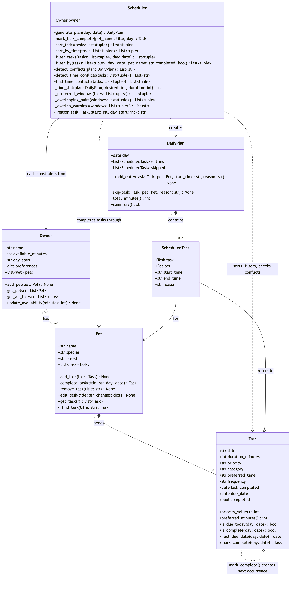

# 🐾 PawPal+

PawPal+ is a Streamlit app that helps a busy pet owner plan a day of pet care. You enter your pets, their care tasks and how much time you have. PawPal+ builds a timed daily plan, explains each choice, warns you about time conflicts, and keeps daily and weekly tasks coming back on schedule.

## ✨ Features

- **Priority-based daily plan.** `Scheduler.generate_plan()` places higher priority tasks first, at their preferred time when it's free, and otherwise at the next free slot. It stays within the owner's time budget and the owner's day start. Each entry says *why* it was placed there. Tasks that don't fit are listed as skipped, with a reason.
- **Sorting by time.** `Scheduler.sort_by_time()` orders tasks chronologically. Clock times (`"08:00"`) and named times (`"morning"`, `"afternoon"`, `"evening"`) sort together, and tasks with no preferred time go last.
- **Filtering by pet and status.** `Scheduler.filter_by()` shows one pet's tasks, only pending or only done tasks, or both filters together.
- **Daily and weekly recurrence.** Marking a task complete (`Scheduler.mark_task_complete()`) creates its next occurrence automatically, due the next day (daily) or 7 days later (weekly), using `timedelta`.
- **Conflict warnings.** `Scheduler.detect_time_conflicts()` flags tasks whose requested times overlap, for the same pet or for different pets. It returns warnings instead of crashing, and the plan still works around the clash.
- **Input validation.** Invalid durations, priorities, frequencies and times (such as `"25:00"` or `"12:60"`) are rejected with a clear message, and so are duplicate pet names and duplicate pending task titles.

## Scenario

A busy pet owner needs help staying consistent with pet care. They want an assistant that can:

- Track pet care tasks (walks, feeding, meds, enrichment, grooming, etc.)
- Consider constraints (time available, priority, owner preferences)
- Produce a daily plan and explain why it chose that plan

## Getting started

### Setup

```bash
python -m venv .venv
source .venv/bin/activate  # Windows: .venv\Scripts\activate
pip install -r requirements.txt
```

### Run it

```bash
streamlit run app.py     # the web app
python main.py           # terminal demo with a sample household
python -m pytest         # the test suite
```

### Project layout

| File | What it holds |
|------|---------------|
| `pawpal_system.py` | The logic layer: `Owner`, `Pet`, `Task`, `Scheduler`, `DailyPlan`, `ScheduledTask` |
| `app.py` | The Streamlit UI |
| `main.py` | A terminal demo that prints each scheduling step |
| `tests/test_pawpal.py` | Automated tests |
| `diagrams/uml_final.mmd` | Final UML class diagram (Mermaid source); `uml.mmd` is the first draft |

## 🏗️ System Design



An `Owner` has pets, each `Pet` owns its `Task`s, and the `Scheduler` reads the owner's tasks and constraints to produce a `DailyPlan` of `ScheduledTask` entries. Completing a recurring `Task` creates the next `Task` occurrence. The Mermaid source is in [`diagrams/uml_final.mmd`](diagrams/uml_final.mmd).

## 🖥️ Sample Output

Full output of `python main.py`, which builds a sample household (Biscuit the dog, Luna the cat) with tasks added out of order on purpose:

```

1. TASKS AS ENTERED (unordered)
----------------------------------------------------------------
  Evening walk    Biscuit   medium    25 min   18:00         due now
  Morning walk    Biscuit   high      30 min   07:30         due now
  Breakfast       Biscuit   high      10 min   08:00         due now
  Meds            Biscuit   high       5 min   08:00         due now
  Play session    Luna      low       20 min   afternoon     due now
  Nail trim       Luna      low       15 min   no preference done
  Litter box      Luna      high      10 min   09:00         due now
  Breakfast       Luna      high      10 min   08:00         due now
  Nail trim       Luna      low       15 min   no preference due 2026-10-27

2. AFTER filter_tasks() - only tasks due today
----------------------------------------------------------------
  Evening walk    Biscuit   medium    25 min   18:00         due now
  Morning walk    Biscuit   high      30 min   07:30         due now
  Breakfast       Biscuit   high      10 min   08:00         due now
  Meds            Biscuit   high       5 min   08:00         due now
  Play session    Luna      low       20 min   afternoon     due now
  Litter box      Luna      high      10 min   09:00         due now
  Breakfast       Luna      high      10 min   08:00         due now
  filtered out: Nail trim (Luna) - already completed today
  filtered out: Nail trim (Luna) - next occurrence, due 2026-10-27

3. AFTER sort_tasks() - high priority and earlier times first
----------------------------------------------------------------
  Morning walk    Biscuit   high      30 min   07:30         due now
  Meds            Biscuit   high       5 min   08:00         due now
  Breakfast       Biscuit   high      10 min   08:00         due now
  Breakfast       Luna      high      10 min   08:00         due now
  Litter box      Luna      high      10 min   09:00         due now
  Evening walk    Biscuit   medium    25 min   18:00         due now
  Play session    Luna      low       20 min   afternoon     due now

4. detect_time_conflicts() - tasks asking for overlapping times
----------------------------------------------------------------
  WARNING: Conflict, same pet (Biscuit): Breakfast (Biscuit, 08:00-08:10) overlaps Meds (Biscuit, 08:00-08:05)
  WARNING: Conflict, different pets: Breakfast (Biscuit, 08:00-08:10) overlaps Breakfast (Luna, 08:00-08:10)
  WARNING: Conflict, different pets: Meds (Biscuit, 08:00-08:05) overlaps Breakfast (Luna, 08:00-08:10)

================================================================
TODAY'S SCHEDULE - Tuesday, October 20, 2026
Owner: Marcos   |   Time available: 90 min
================================================================
TIME          TASK                PET       PRIORITY   MIN
----------------------------------------------------------------
08:00-08:30   Morning walk        Biscuit   high        30
08:30-08:35   Meds                Biscuit   high         5
08:35-08:45   Breakfast           Biscuit   high        10
08:45-08:55   Breakfast           Luna      high        10
09:00-09:10   Litter box          Luna      high        10
18:00-18:25   Evening walk        Biscuit   medium      25
----------------------------------------------------------------
Scheduled: 90 min of 90 min (0 min free)

SKIPPED (ran out of time)
  - Play session (Luna): needs 20 min but only 0 min left
================================================================
Final plan overlaps: none

6. AFTER mark_task_complete('Biscuit', 'Breakfast') - Biscuit's tasks
----------------------------------------------------------------
  Evening walk    Biscuit   medium    25 min   18:00         due now
  Morning walk    Biscuit   high      30 min   07:30         due now
  Breakfast       Biscuit   high      10 min   08:00         done
  Meds            Biscuit   high       5 min   08:00         due now
  Breakfast       Biscuit   high      10 min   08:00         due 2026-10-21
  Breakfast is daily, so the next one is due 2026-10-20 + 1 day = 2026-10-21
```

## 🧪 Testing PawPal+

Run the test suite from the project folder:

```bash
python -m pytest
```

The tests are in `tests/test_pawpal.py` (25 tests). They use fixed dates, so the results don't depend on what day you run them. They cover:

- **Sorting:** `sort_by_time()` returns tasks in chronological order, including `"00:00"`, and tasks at the same time keep the order they were added. The finished plan lists entries by start time, even though high priority tasks are placed first.
- **Filtering:** `filter_by()` works by pet name, by completion status, and by both together. Tasks that are done or not due yet are left out of the plan.
- **Recurrence:** completing a daily task creates a new task due the next day. That task is missing from today's plan and appears in tomorrow's. A weekly task isn't due on day 6 but is due on day 7, including across a month boundary. Completing a task for an unknown pet raises an error.
- **Conflict detection:** two tasks at exactly the same time are flagged. So are overlapping windows, for the same pet or for different pets, and `"morning"` clashing with `"08:00"`. Back-to-back tasks and tasks with no preferred time are not flagged. `find_time_conflicts()` returns the exact tasks behind each warning, and a generated plan never contains overlaps.
- **Edge cases:** an owner with no pets or a pet with no tasks, a zero time budget, a task that would run past midnight, a preferred time before the owner's day starts, and invalid times such as `"25:00"`, `"12:60"` or `"noon"`.

Successful run:

```
============================= test session starts ==============================
platform darwin -- Python 3.13.0, pytest-9.1.1, pluggy-1.7.0
rootdir: /Users/marcosdelvado/Documents/FAU/Clases/Fall 2026/CEN 4010 Software Engineering/Assignments/week4class
collected 25 items

tests/test_pawpal.py .........................                           [100%]

============================== 25 passed in 0.02s ==============================
```

**Confidence level: ★★★★☆ (4/5)**

The core scheduling rules are well covered, with happy paths and edge cases for sorting, filtering, recurrence and conflicts, and every test passes. Writing these tests also caught a real bug: `"12:60"` was being accepted as a valid time. It isn't 5 stars because:

- The Streamlit UI in `app.py` isn't tested.
- Multi-day scenarios are only partly tested, beyond "today and tomorrow".
- Completing the same daily task twice on one day completes tomorrow's copy early. The schedule is still right, but the history gets an extra "done" record.

## 📐 Smarter Scheduling

On top of the basic plan, the `Scheduler` can sort and filter tasks, repeat daily and weekly tasks, and warn about time conflicts. All of this logic lives in `pawpal_system.py`. Each method below works on `(pet, task)` pairs from `Owner.get_all_tasks()`, so every task stays linked to its pet.

| Feature | Method(s) | Notes |
|---------|-----------|-------|
| Task sorting | `Scheduler.sort_by_time()`, `Scheduler.sort_tasks()` | By preferred time; or by priority, then time, then duration |
| Filtering | `Scheduler.filter_by()`, `Scheduler.filter_tasks()` | By pet name and/or completion status; or only tasks due today |
| Conflict handling | `Scheduler.detect_time_conflicts()`, `Scheduler.find_time_conflicts()`, `Scheduler.detect_conflicts()` | Overlapping time windows, same pet or different pets; warns, never crashes |
| Recurring tasks | `Task.mark_complete()`, `Pet.complete_task()`, `Scheduler.mark_task_complete()` | Completing a task creates the next occurrence: +1 day (daily) or +7 days (weekly) |

### Sorting

- **`Scheduler.sort_by_time(tasks)`** puts tasks in order of preferred time, earliest first. It uses `sorted()` with a lambda key that turns each time into minutes after midnight. That way `"HH:MM"` times and named times (`"morning"` = 08:00, `"afternoon"` = 12:00, `"evening"` = 17:00) sort together correctly. The key is a tuple, `(no preferred time?, minutes)`, so tasks with no preferred time go last.
- **`Scheduler.sort_tasks(tasks)`** is the order `generate_plan()` uses: higher priority first, then earlier preferred time, then shorter duration. Higher-priority tasks claim their time slots first.

### Filtering

- **`Scheduler.filter_by(tasks, day, pet_name=None, completed=None)`** keeps the tasks that match a pet name, a completion status, or both. Any filter left as `None` is ignored. For example, `filter_by(tasks, today, pet_name="Luna", completed=False)` returns Luna's pending tasks.
- **`Scheduler.filter_tasks(tasks, day)`** keeps only the tasks that are due on that day, using `Task.is_due_today()`. `generate_plan()` uses it to drop tasks that are already done and occurrences that aren't due yet.

### Recurring tasks

- **`Task.mark_complete(day)`** marks the task done and returns a new copy for the next occurrence. The copy is due on `Task.next_due_date(day)`, which is `day + timedelta(days=1)` for daily tasks and `day + timedelta(days=7)` for weekly ones. Using `timedelta` means month and year boundaries are handled for you, so a weekly task done on Oct 28 is next due Nov 4.
- **`Pet.complete_task(title, day)`** completes the pet's pending task with that title and adds the next occurrence to the pet's task list. The completed copy stays in the list as history.
- **`Scheduler.mark_task_complete(pet_name, title, day)`** does the same thing, looking up the pet by name.
- A new occurrence stays out of the plan until its due date, because `Task.is_due_today()` checks `due_date`.

### Conflict detection

- **`Scheduler.detect_time_conflicts(tasks)`** checks the times tasks *ask* for, before the plan is built. Each task with a preferred time asks for the window from its preferred time to preferred time + duration. The method sorts the windows by start time and compares each one only with the windows that start before it ends. For every overlap it returns a warning string, labelled "same pet" or "different pets." It never raises an error and never changes a task. Back-to-back tasks, where one ends at 08:00 and the next starts at 08:00, are not conflicts. Tasks with no preferred time are not checked.
- **`Scheduler.detect_conflicts(plan)`** runs the same check on a finished `DailyPlan`. `generate_plan()` moves a clashing task to the next free slot, so this should always come back empty. It's there as a safety check.
- **`Scheduler.find_time_conflicts(tasks)`** runs the same check as `detect_time_conflicts()`, but returns the clashing `(pet, task)` pairs instead of strings. The Streamlit app uses it to write warnings that say where each task ended up.
- All three share the same sweep, `Scheduler._overlapping_pairs()`.

## 📸 Demo Walkthrough

### Main UI features

The Streamlit app (`streamlit run app.py`) is one page with four sections:

1. **Owner.** Set your name, how many minutes you have for pet care today, and when your day starts.
2. **Pets.** Add each pet with a name, species and optional breed. Duplicate names are rejected.
3. **Tasks.**
   - **Add a task:** choose the pet, then enter a title, duration, priority, how often it repeats (daily or weekly), a category, and an optional preferred time (`08:00` or `morning`).
   - **All tasks table:** every pet's tasks in one table, **sorted by preferred time**, with a status column: *due today*, *✅ done*, or *due Oct 27*.
   - **Filters:** "Show pet" and "Show status" (All / Pending / Done) narrow the table.
   - **Mark a task done:** completes the task, and a green message says when the next occurrence is due.
4. **Today's schedule.**
   - **Generate schedule** builds the plan. It stays on screen and updates as you complete tasks.
   - **Conflict warnings** appear first, as ⏰ yellow boxes. Each one names the clashing tasks, says where PawPal+ placed each one, and suggests changing a preferred time.
   - A **summary** follows: green when everything fits, yellow when some tasks were skipped.
   - The plan is a **table** with time, task, pet, priority and a "Why" column. Skipped tasks get their own table with the reason.

### Example workflow

1. In **Owner**, set *Time available* to `60` and *Day starts at* to `08:00`, then click **Save owner**.
2. In **Pets**, add **Biscuit** (dog) and **Luna** (cat).
3. In **Tasks**, add Biscuit's *Morning walk* (30 min, high, `07:30`), *Breakfast* (10 min, high, `08:00`) and *Meds* (5 min, high, `08:00`). Then add Luna's *Breakfast* (10 min, high, `08:00`) and *Play session* (20 min, low, `afternoon`).
4. Look at **All tasks**. It's sorted by time, not by the order you entered things. Set *Show pet* to Luna to see only Luna's tasks.
5. Click **Generate schedule**. Three ⏰ conflict warnings appear for the 08:00 clashes, for example: *"Biscuit's Breakfast (08:00, 10 min) overlaps Luna's Breakfast (08:00, 10 min). You can only do one at a time, so PawPal+ placed Biscuit's Breakfast at 08:35 and Luna's Breakfast at 08:45. To keep both on time, change one task's preferred time."*
6. Read the plan. The morning walk starts at 08:00, not 07:30, because the day starts at 08:00 (the "Why" column says so). The 08:00 tasks follow one after another, and *Play session* is skipped: it needs 20 minutes, but only 5 of the 60 are left.
7. Under **Mark a task done**, choose *Breakfast (Biscuit)* and click **Mark complete**. The message says the next one is due tomorrow. The table now shows one *✅ done* Breakfast and one *due* tomorrow. The plan updates and drops the warnings that involved Biscuit's Breakfast.

### Key Scheduler behaviors shown

- **Sorting:** the task table uses `sort_by_time()`, and the plan places tasks by priority with `sort_tasks()`.
- **Filtering:** the table filters use `filter_by()`, and the plan only includes tasks due today, through `filter_tasks()`.
- **Conflict warnings:** `find_time_conflicts()` runs on today's due tasks before the plan is shown.
- **Recurrence:** `mark_task_complete()` creates the next daily or weekly occurrence. Because of its due date, it stays out of today's plan.
- **Time budget and day start:** handled by `generate_plan()`, with a reason for every placed and skipped task.

### Sample CLI output

The key part of `python main.py`: conflict warnings, the resulting plan, and recurrence after a task is completed. The full output is in the Sample Output section above.

```
4. detect_time_conflicts() - tasks asking for overlapping times
----------------------------------------------------------------
  WARNING: Conflict, same pet (Biscuit): Breakfast (Biscuit, 08:00-08:10) overlaps Meds (Biscuit, 08:00-08:05)
  WARNING: Conflict, different pets: Breakfast (Biscuit, 08:00-08:10) overlaps Breakfast (Luna, 08:00-08:10)
  WARNING: Conflict, different pets: Meds (Biscuit, 08:00-08:05) overlaps Breakfast (Luna, 08:00-08:10)

================================================================
TODAY'S SCHEDULE - Tuesday, October 20, 2026
Owner: Marcos   |   Time available: 90 min
================================================================
TIME          TASK                PET       PRIORITY   MIN
----------------------------------------------------------------
08:00-08:30   Morning walk        Biscuit   high        30
08:30-08:35   Meds                Biscuit   high         5
08:35-08:45   Breakfast           Biscuit   high        10
08:45-08:55   Breakfast           Luna      high        10
09:00-09:10   Litter box          Luna      high        10
18:00-18:25   Evening walk        Biscuit   medium      25
----------------------------------------------------------------
Scheduled: 90 min of 90 min (0 min free)

SKIPPED (ran out of time)
  - Play session (Luna): needs 20 min but only 0 min left
================================================================
Final plan overlaps: none

6. AFTER mark_task_complete('Biscuit', 'Breakfast') - Biscuit's tasks
----------------------------------------------------------------
  Evening walk    Biscuit   medium    25 min   18:00         due now
  Morning walk    Biscuit   high      30 min   07:30         due now
  Breakfast       Biscuit   high      10 min   08:00         done
  Meds            Biscuit   high       5 min   08:00         due now
  Breakfast       Biscuit   high      10 min   08:00         due 2026-10-21
  Breakfast is daily, so the next one is due 2026-10-20 + 1 day = 2026-10-21
```
